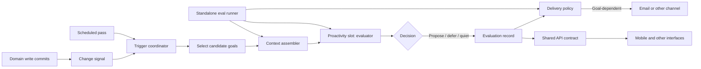

# Proactivity Engine — PRD

## Problem

Hominem should help people achieve their goals without requiring them to ask
the right question at the right time. It needs to notice when new information
materially changes a goal, and periodically reassess goals when no single
change is decisive. The engine must be testable on its own so its behavior can
be improved without launching or coupling tests to a client interface.

## Goals and non-goals

- **Goals**
  - A critical change to a person's data can trigger evaluation of the goals
    it may affect.
  - Scheduled evaluation can reassess all active goals against the latest
    available state.
  - Evaluation compares prior and new state, considers evidence across
    relevant domains, and returns an inspectable decision with evidence.
  - A standalone eval suite can test expected behavior using synthetic goal
    and state-transition cases, without any UI app.
  - Delivery can vary by goal and decision; supported examples include an
    email for an imminent budget overrun and a weekly email summarizing the
    person's current state of the world.
  - The mobile interface can show a person's goals and their current state.
- **Non-goals**
  - Define a separate intelligence or goal system for each client app.
  - Treat every detected change as a user-facing interruption.
  - Let evaluation directly perform consequential actions on the person's
    behalf.
  - Finalize goal onboarding, interface navigation, email copy, or a full
    domain data model in this PRD.

## Users

- **Person with goals** — states goals, sees progress and relevant changes,
  and receives timely, goal-appropriate updates.
- **Product and engineering team** — runs repeatable scenario evaluations of
  engine decisions without a client app or live personal data.

## Feature specifications

### Feature F-01: Goal-centered evaluation

**Actor**: Hominem brain (API/MCP server)
**Data**: User-defined goals; prior and new relevant domain state; timestamps;
source and freshness for evidence
**Trust Boundaries**: Domain data and event sources → API-owned evaluation →
stored or delivered proposal

**Updated Requirements**:

- Goals are the initial unit of proactivity.
- A critical data change triggers evaluation for the goals it may affect.
- Scheduled passes evaluate all active goals against current available data.
- Evaluation output distinguishes evidence, inference, uncertainty, and
  recommendation.
- An evaluation can decide to propose, defer, or stay quiet; no-change cases
  are valid expected outcomes.

**Acceptance Criteria**:

- Given a critical change that affects an active goal, the evaluator returns
  a decision based on the prior and new state and cites the supporting facts.
- Given a change unrelated to a goal, the evaluator does not invent an effect
  or fabricate supporting evidence.
- Given a scheduled pass, each active goal is evaluated against the supplied
  current state even if no critical-change event was received.
- Given missing, stale, conflicting, or insufficient evidence, the output
  identifies that condition and does not present an unsupported conclusion
  as fact.
- Given an unchanged state with no useful action, the evaluator returns a
  quiet decision instead of a redundant proposal.

### Feature F-02: Critical-change and scheduled triggers

**Actor**: API event handling and scheduled worker
**Data**: Changed record or domain signal; affected owner; active goal
references; evaluation time
**Trust Boundaries**: Domain mutation or scheduler → trigger selection →
goal-centered evaluator

**Updated Requirements**:

- Specific critical data changes trigger prompt evaluation.
- A scheduled pass is the coverage path for changes that do not need an
  immediate evaluation.
- Trigger selection and evaluation are independently observable in test
  results.

**Acceptance Criteria**:

- Given a registered critical change, the trigger selects affected goals and
  starts evaluation without waiting for the scheduled pass.
- Given a non-critical change, the scheduled pass eventually evaluates any
  affected active goal.
- Replaying the same change does not create duplicate equivalent proposals.
- A scheduled pass can be run with a supplied clock in a test environment.

### Feature F-03: Goal-dependent delivery

**Actor**: API-owned delivery policy and delivery adapters
**Data**: Goal; evaluation decision; evidence; proposed message; user delivery
preferences and contact channel
**Trust Boundaries**: Evaluation output → delivery policy → email provider
and other future channels

**Updated Requirements**:

- Delivery is selected according to the goal and the evaluation decision.
- An imminent budget overrun may produce an email.
- A weekly email may summarize the person's current state of the world in
  relation to their goals.
- The engine's evaluation contract does not depend on an email provider or a
  client app.

**Acceptance Criteria**:

- Given an imminent budget overrun that threatens an active goal, the
  evaluation produces a goal-linked proposal that the delivery policy can
  route to email.
- Given a scheduled weekly summary, the content is grounded in the current
  state of the world and explains material changes in relation to active
  goals where relevant.
- Given no meaningful goal change or action, a weekly summary does not invent
  progress or risks.
- A delivery failure does not erase the evaluation decision or its evidence.

### Feature F-04: Standalone proactivity evaluations

**Actor**: Product and engineering team
**Data**: Synthetic goal definitions; prior and new state fixtures; fixed
clock; expected decision and evidence
**Trust Boundaries**: Eval runner → deterministic evaluator/model adapter;
no UI app or live personal data

**Updated Requirements**:

- Each case supplies a goal and both prior and new state, so tests measure
  response to change rather than only a static snapshot.
- Cases cover immediate critical-change evaluation, scheduled evaluation,
  proposal, defer, and quiet outcomes.
- Deterministic assertions validate contract shape and evidence references;
  model grading may assess the quality and relevance of the reasoning.
- Regression cases and holdout cases are separate so tuning does not leak
  every evaluation case into development.

**Acceptance Criteria**:

- The eval command runs without starting Omiro, Web, Career, or Finance.
- The same fixture and fixed clock produce the same trigger inputs and
  contract shape across repeated runs.
- Every result records the case id, goal, prior/new state identifiers,
  trigger type, decision, evidence references, and grader result.
- A case fails when the engine misses an expected material change, invents
  evidence, recommends an unsupported action, or proposes an intervention in
  a specified quiet case.

### Feature F-05: Mobile goals interface

**Actor**: Person using the mobile interface
**Data**: Goals; goal progress and status; recent evaluations and proposals
**Trust Boundaries**: Mobile client → authenticated API contract

**Updated Requirements**:

- The mobile interface lets a person see their goals and relevant current
  state.
- The API remains the owner of goals and proactivity decisions; mobile is a
  client interface to the same Hominem product.

**Acceptance Criteria**:

- A person can inspect their active goals and the latest goal-linked state
  supplied by the API.
- A person can distinguish current facts from an AI inference or recommendation.
- The interface can render a goal with no recent evaluation and a goal with
  an available proposal.

## Component sketch

The proactivity engine is an optional capability slot composed into the API
runtime. Clients call the same brain APIs whether the slot is enabled or not;
they do not host trigger logic, goal reasoning, or delivery policy. The first
slot owns evaluation only. The API runtime owns orchestration and integrations.

| Component               | Responsibility                                                                                                                                                     | Boundary                                                                                                  |
| ----------------------- | ------------------------------------------------------------------------------------------------------------------------------------------------------------------ | --------------------------------------------------------------------------------------------------------- |
| Change signal           | Describe a successfully committed change, its owner, source, time, and the before/after evidence needed to evaluate it.                                            | Emitted by the application operation that owns the write.                                                 |
| Trigger coordinator     | Distinguish critical-change requests from scheduled passes and deduplicate repeat requests.                                                                        | API runtime; no client participation.                                                                     |
| Candidate-goal selector | Choose which active goals could be affected by a signal; scheduled passes select all active goals.                                                                 | Brain-owned goal and signal semantics. Exact selection policy is open.                                    |
| Context assembler       | Resolve goal-relevant state and evidence into a bounded input, retaining provenance, freshness, and prior/current distinction.                                     | API-owned domain readers; the evaluator does not query databases or call tools directly.                  |
| Proactivity slot        | Evaluate one goal against supplied context and return propose, defer, or quiet with evidence and uncertainty.                                                      | Replaceable implementation behind a stable contract; no persistence, scheduling, email, or UI dependency. |
| Evaluation record       | Store the decision and evidence references so results can be inspected, deduplicated, and delivered independently.                                                 | API persistence boundary; storage shape is open.                                                          |
| Delivery policy         | Choose whether, when, and where a proposal is sent based on the goal and decision. Generate a weekly current-state summary from current evidence and active goals. | API-owned policy and channel adapters; email is the initial example.                                      |
| Shared API contract     | Let interfaces read goals, current state, and available proposals.                                                                                                 | API/MCP brain; mobile is one consumer.                                                                    |
| Standalone eval runner  | Supply synthetic goals, prior/current evidence, trigger, and fixed time; invoke the same slot and grade the result.                                                | No UI app, live personal data, or delivery provider.                                                      |

Critical-change flow: the owning application operation commits a domain write,
then emits a signal. The trigger coordinator identifies candidate goals and
queues evaluation. The context assembler builds an input that preserves what
changed even if processing happens later. The slot returns a decision; the API
records it before the delivery policy attempts any external send. A delivery
failure therefore leaves the reasoning result available for retry or review.

Scheduled flow: a scheduled request enters the same trigger coordinator and
uses the same evaluator and record path. It evaluates every active goal
against current state. A weekly summary is produced from current evidence and
goal evaluations, then routed by delivery policy. Whether the weekly summary
shares a pass with the regular scheduled sweep or runs separately remains
open.

Eval flow: scenario fixtures supply the goal, prior/current state, trigger,
and clock directly to the context/evaluator boundary. Contract assertions
check evidence references and decision shape; quality grading checks whether
the decision matches the scenario. Trigger-selection and delivery-policy
cases can use the same fixtures with fake adapters. This exercises the brain
without simulating an app.

The current API already has a central worker entry point at
`services/api/src/worker.ts`; it starts focused workers whose handlers delegate
to application services. That is a plausible integration seam, not a final
decision about queue names, event transport, or whether the proactivity slot
needs its own worker.

## Initial cross-domain goal evaluation set

These ten cases form the proposed starting benchmark. They are scenario
families, not an onboarding taxonomy or a claim that every listed data source
is already connected. Each scenario should have positive, quiet, and ambiguous
variants, with prior and new state fixtures.

| ID   | Example goal                                     | Cross-domain evidence to test                                                                  | Example expected behavior                                                                                                         |
| ---- | ------------------------------------------------ | ---------------------------------------------------------------------------------------------- | --------------------------------------------------------------------------------------------------------------------------------- |
| G-01 | Build an emergency fund                          | Finance balances and transactions; income changes; savings tasks                               | Reassess the target date after a material income or spending shift; stay quiet on unrelated changes.                              |
| G-02 | Pay off debt                                     | Finance balances, payments, interest and cash flow; planned actions                            | Surface a changed payoff outlook when new data materially changes it; do not infer a payment from an unverified transaction.      |
| G-03 | Save for a home purchase                         | Savings and affordability; career income; target date and preparation tasks                    | Explain when the deposit trajectory or income change shifts readiness; identify missing affordability inputs.                     |
| G-04 | Change careers                                   | Career history, skills, applications and worklog; finances and tasks                           | Connect an opportunity or application milestone to the stated goal and runway; do not treat generic job activity as intent.       |
| G-05 | Get promoted or grow in current work             | Career worklog, skills, engagement goals and tasks                                             | Notice accumulated evidence or a stalled prerequisite and suggest a grounded next step, without claiming an employer outcome.     |
| G-06 | Start a business                                 | Career skills and projects; finance runway and transactions; tasks and milestones              | Surface a material runway or milestone change and relate it to the launch plan; do not imply business viability from sparse data. |
| G-07 | Improve health or fitness                        | Explicit goal and user-provided health/activity evidence; routines and tasks                   | Reflect only supported trends and commitments; defer when data is absent or ambiguous.                                            |
| G-08 | Take a major trip                                | Travel plans, dates and bookings; finance budget and savings; preparation tasks                | Connect a cost, date, or booking change to readiness and budget; avoid sending stale reminders after plans change.                |
| G-09 | Relocate to a new city                           | Career opportunities; finance runway; travel and possessions; tasks                            | Identify a changed dependency or timeline across domains and explain which evidence creates the risk.                             |
| G-10 | Support a family member or caregiving commitment | People and relationship context; tasks and time commitments; finance where explicitly relevant | Help track explicit commitments and changed capacity; avoid inferring sensitive needs or exposing private details in delivery.    |

For every goal family, include at least these transition shapes: progress,
material setback, unrelated change, conflicting evidence, stale evidence,
missing evidence, goal already achieved or paused, and a repeat of an already
handled change. Cases should state the expected decision and the evidence that
would justify it, not just a preferred prose answer.

## Demo surface

`services/proactivity/studio` is a local, synthetic-data studio that runs the
real engine, model slot, delivery policy, and SQLite journal. It exists to
demonstrate behaviour and inspect decisions during product review. It is not
wired to the API, scheduler, or production data, and it does not resolve any
open question below.

## Open questions

- **Critical-change catalog and severity rules** — OPEN — USER DECISION REQUIRED.
  Which domain changes warrant immediate evaluation, and which thresholds
  define materiality? The budget-overrun email is an example, not a complete
  rule.
- **Signal delivery guarantees** — OPEN — USER DECISION REQUIRED. How does a
  committed change become a durable, replayable evaluation request, and what
  guarantees prevent a write from being lost between commit and enqueue?
- **Slot activation and rollout** — OPEN — USER DECISION REQUIRED. Is the
  capability enabled per deployment, per person, or through another control?
- **Goal creation and lifecycle** — OPEN — USER DECISION REQUIRED. Are goals
  always explicitly created by the person, can Hominem suggest them, and how
  are achieved, paused, or abandoned goals represented?
- **Goal benchmark approval** — OPEN — USER DECISION REQUIRED. Are these ten
  goal families the initial eval set, and which should be excluded or replaced?
- **Scheduled cadence** — OPEN — USER DECISION REQUIRED. The weekly email is
  specified; the cadence for non-email scheduled evaluation is not, nor
  whether the digest shares the regular goal sweep.
- **Delivery policy and consent** — OPEN — USER DECISION REQUIRED. Define
  quiet hours, preferences, opt-outs, escalation, and which goal decisions
  qualify for immediate email.
- **Engine and state ownership details** — OPEN — USER DECISION REQUIRED.
  Define the API application boundary, event source, persistence model,
  idempotency key, and model involvement after reviewing the contract.
- **Mobile goal interaction scope** — OPEN — USER DECISION REQUIRED. Viewing
  goals is specified; create, edit, pause, and completion interactions remain
  undecided.
- **Domain availability** — OPEN — USER DECISION REQUIRED. Confirm which
  health, calendar/time, and other sources are in the initial evaluation
  boundary and what freshness guarantees they provide.

## Out of scope

- Selecting specific database tables, queue technology, email provider, or
  model before the contract and ownership are reviewed.
- Treating the ten benchmark goals as mandatory goal categories in the mobile
  interface.
- Shipping a production client-specific proactivity flow. The local studio is
  a review and demonstration surface, not a product client.
- Taking irreversible financial, career, health, travel, or communication
  actions without a separate explicit product decision.
